<div align="center">


<br>

<a href="https://www.linkedin.com/in/chamikaranaweera/"></a>
<a href="mailto:chamikaranaweera30@gmail.com"></a>
<a href="https://tryhackme.com/p/seasonsofyjinn"></a>
<a href="https://cve-dashboard-pup2.onrender.com"></a>

<br><br>


</div>

<br>

<details open>
<summary><b>Skimming? The 20-second version</b></summary>

<br>

- **Who:** cybersecurity undergraduate in Sri Lanka, looking for an **internship abroad in 2026**.
- **Proof of work:** 8 security tools built end to end and 1 deployed live. A phishing model at **97.2%** accuracy, **9 real vulnerabilities** found on DVWA (one CRITICAL SQL injection), **80 CVEs** surfaced across 5 packages.
- **Where I'm strongest:** detection tooling, web app testing, email / BEC security, software supply chain (OSV, SBOM), ML for security.
- **Reach me:** [LinkedIn](https://www.linkedin.com/in/chamikaranaweera/) or [chamikaranaweera30@gmail.com](mailto:chamikaranaweera30@gmail.com).

</details>

<br>

<h2></h2>

```console
chamika@sec-lab:~$ cat whoami.txt
name         Chamika Ranaweera
role         Cybersecurity undergraduate
location     Sri Lanka
focus        network security · web app security · threat intelligence
philosophy   Don't just study attacks - build the tools that detect them.
goal         cybersecurity internship abroad (2026)
status       [ONLINE] shipping tools, breaking labs, learning in public
```

I learn security by building the tools defenders use: a phishing classifier, a packet analyzer, a web scanner, a live CVE feed, supply-chain scanners. Then I point them at real targets (labs, real datasets, real vulnerability databases) and see what breaks.

```console
chamika@sec-lab:~$ git log --oneline --graph
* ???????  internship                 a real security team, abroad, 2026    <- next
* a8e41f2  digital-security-toolkit   k-anonymity breach check + metadata stripper
* 7c3b9d0  sbom-scanner               CycloneDX 1.4 SBOMs checked against OSV
* 51fa6e8  dependency-scanner         80 CVEs surfaced across 5 packages
* 3d92c74  email-auth-analyzer        SPF / DKIM / DMARC + look-alike domains
* e07b1a5  cve-dashboard              deployed LIVE, pulling from NIST NVD
* 9b6d3f1  web-vulnerability-scanner  9 vulns on DVWA, 1 CRITICAL SQLi
* 4c8a2e7  network-analyzer           port scans + ARP spoofing, caught live
* 1f5e0b3  phishing-detector          97.20% accuracy on 5,172 real emails
* 0000000  init                       curiosity
```

<br>

<h2></h2>

<div align="center">
</div>

<details>
<summary><b>Receipts</b> - every skill, linked to the project that proves it</summary>

<br>

| Domain | What I can do | Receipt |
|:--|:--|:--|
| **Network security** | Capture and analyze live traffic, detect port scans and ARP spoofing | [network-analyzer](https://github.com/chamika-r/network-analyzer) |
| **Web app security** | Test for OWASP Top 10 issues, validate findings on DVWA, write pentest reports with remediation | [web-vulnerability-scanner](https://github.com/chamika-r/web-vulnerability-scanner) |
| **Email & identity security** | Analyze SPF / DKIM / DMARC, detect look-alike domains, score BEC risk | [email-auth-analyzer](https://github.com/chamika-r/email-auth-analyzer) |
| **Supply-chain security** | Scan dependencies against OSV, generate CycloneDX SBOMs | [dependency-scanner](https://github.com/chamika-r/dependency-scanner) · [sbom-scanner](https://github.com/chamika-r/sbom-scanner) |
| **Threat intelligence** | Ingest and present live NVD data, ship it as a deployed service | [cve-dashboard](https://github.com/chamika-r/cve-dashboard) |
| **ML for security** | Feature engineering and model training for detection, explainable outputs | [phishing-detector](https://github.com/chamika-r/phishing-detector) |
| **Privacy engineering** | k-anonymity protocols, metadata removal | [digital-security-toolkit](https://github.com/chamika-r/digital-security-toolkit) |

`Python` `Flask` `scikit-learn` `Scapy` `SQLite` `Docker` `Git` `Linux` `OSV` `HIBP` `CycloneDX` `MITRE ATT&CK`

</details>

<br>

<h2></h2>

<p align="center">
<a href="https://github.com/chamika-r/phishing-detector">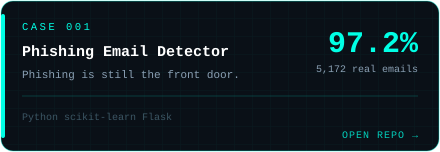</a>
<a href="https://github.com/chamika-r/network-analyzer">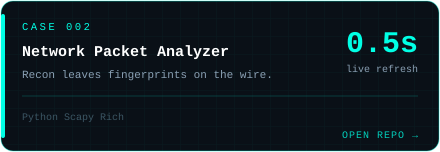</a>
<a href="https://github.com/chamika-r/web-vulnerability-scanner">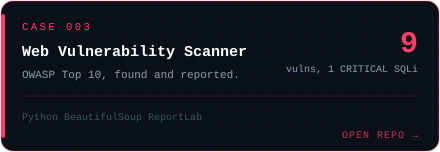</a>
<a href="https://github.com/chamika-r/cve-dashboard">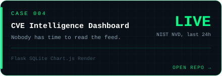</a>
<a href="https://github.com/chamika-r/email-auth-analyzer">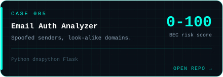</a>
<a href="https://github.com/chamika-r/dependency-scanner">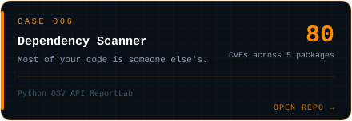</a>
<a href="https://github.com/chamika-r/sbom-scanner">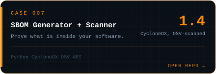</a>
<a href="https://github.com/chamika-r/digital-security-toolkit">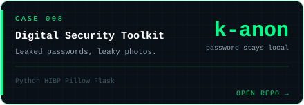</a>
</p>

<details>
<summary><b>Full case notes</b> - the threat, what I built, what came out of it</summary>

<br>

**001 · Phishing Email Detector** — *Threat:* phishing is still the front door for most intrusions, and users can't tell why a message looks wrong. *Built:* a Logistic Regression model trained on **5,172 real emails**, behind a Flask REST API that returns a confidence score and a plain-English explanation of the suspicious indicators. *Result:* **97.20%** accuracy.

**002 · Network Packet Analyzer** — *Threat:* recon and man-in-the-middle attacks leave fingerprints on the wire long before anything else breaks. *Built:* a real-time analyzer that captures live packets with Scapy and detects **port scanning** and **ARP spoofing** as they happen, in a Rich terminal dashboard that refreshes every 0.5 seconds. *Result:* live alerts straight from the wire.

**003 · Web Vulnerability Scanner** — *Threat:* the OWASP Top 10 classes of bugs that keep showing up in real web apps. *Built:* a scanner that tests for them and writes a professional PDF penetration-test report with severity ratings and remediation guidance. *Result:* pointed at DVWA, it found **9 real vulnerabilities**, including a **CRITICAL SQL injection**.

**004 · CVE Intelligence Dashboard** — *Threat:* new vulnerabilities are published every day and nobody has time to read the feed. *Built:* a dashboard that pulls the NIST NVD in real time into SQLite and shows the last 24 hours of CVEs with severity filters, trend charts and search. *Result:* deployed and **running live**: [open it](https://cve-dashboard-pup2.onrender.com).

**005 · Email Authentication Analyzer** — *Threat:* Business Email Compromise, meaning spoofed senders and look-alike domains (`paypa1.com` posing as `paypal.com`). *Built:* a tool that takes a raw `.eml`, checks **SPF, DKIM and DMARC** with live DNS lookups, catches look-alike domains with Levenshtein distance, and combines everything into a 0-100 risk score, as a CLI and a web UI. *Result:* one explainable verdict per suspicious email.

**006 · Dependency Vulnerability Scanner** — *Threat:* most of the code in a project is code somebody else wrote, and it ages badly. *Built:* a scanner for `requirements.txt` and `package.json` that checks the **Google OSV database** (the data behind GitHub Dependabot), reports fix versions and generates PDF reports. *Result:* **80 CVEs** surfaced across 5 packages in testing.

**007 · SBOM Generator + Scanner** — *Threat:* software supply-chain attacks, and regulators now asking vendors to prove what is inside their software. *Built:* a generator that walks a project and produces a formal **CycloneDX 1.4** SBOM with Package URLs, cross-references every component against OSV, and exports the SBOM as JSON. Built around the SBOM expectations of US Executive Order 14028 and the EU Cyber Resilience Act. *Result:* source tree to standards-based SBOM to vulnerability report in one run.

**008 · Digital Security Toolkit** — *Threat:* leaked passwords, and photos that quietly carry your GPS location and device details. *Built:* a **password breach checker** using HIBP k-anonymity, where only a 5-character SHA-1 prefix is sent and the password never leaves the device, and an **image metadata stripper** that removes GPS, device info and timestamps. *Result:* a breach check where the password itself never leaves the device.

</details>

<br>

<h2></h2>

<div align="center">

### CVE Intelligence Dashboard

**Real-time vulnerability intelligence from the NIST National Vulnerability Database.**
CVEs from the last 24 hours, with severity filtering, trend charts and a searchable history.

<a href="https://cve-dashboard-pup2.onrender.com"></a>
<a href="https://github.com/chamika-r/cve-dashboard"></a>

<sub>Free hosting: the first load can take ~30 seconds to wake the server up.</sub>

`Python` `Flask` `SQLite` `Chart.js` `Render`

</div>

<br>

<!-- ================= CTF SECTION ================= -->

<h2></h2>

<div align="center">

</div>

<br>

I hid a flag somewhere in this profile. You don't need to install anything and there is nothing to attack: **everything you need is in this README and in the [`ctf/`](ctf/) folder.** It takes three techniques (decoding, recon, log analysis) and about 10-20 minutes. Solve it, claim your flag, and get on the wall of fame.

Flag format: `FLAG{...}`

```text
============ INTERCEPTED TRANSMISSION 0x01 ============
Tm90IGV2ZXJ5dGhpbmcgb24gdGhpcyBwYWdlIGlzIHJlbmRlcmVkLiBSZWFkIHRoZSByYXcgc291cmNlLg==
=======================================================
```

<!--
  STAGE 1 :: cipher text
  Fgntr 1 pyrne. N jro freire jnf cbccrq va gur rneyl ubhef bs 14 Frc 2026. Gur rivqrapr vf va pgs/npprff.ybt. Svaq gur VC gung oehgr-sbeprq /nqzva/ybtva NAQ tbg va, gura ybbx ng jung vg chyyrq bhg arkg. Ybbg vf rapbqrq gjvpr.
-->

<details>
<summary><b>Stuck? Open a hint</b> (spoiler-light, one per stage)</summary>

- **Stage 0:** The transmission ends in `=`. That's a big clue about the encoding.
- **Stage 1:** Browsers don't render everything they're given. On github.com you can view this file's **Raw** source. One of the things a browser hides is *comments*. The text you'll find uses one of the oldest ciphers there is: a rotation by 13.
- **Stage 2:** Start with who is hammering the login page:
  `grep ' 401 ' ctf/access.log | awk '{print $1}' | sort | uniq -c | sort -rn`
  Not everyone with a few `401`s is an attacker. Look for the source that fails **many** times and then **succeeds** (`302`), then read what that same IP requested *afterwards*. Several requests carry a `ref=` value; only one belongs to the attacker.
- **Stage 2 (decoding):** Loot is encoded twice: **hex**, then **base64**. Try `echo <hex> | xxd -r -p | base64 -d`.

</details>

### Stage 3: claim your flag

Your flag never has to appear in public. Instead, submit a **salted proof of solve**: the SHA-256 of your flag joined to your (lowercase) GitHub username.

```bash
printf '%s' 'FLAG{your_flag_here}:your-github-username' | shasum -a 256
```

`shasum -a 256` works on macOS and Linux (`sha256sum` also works on Linux). Copy only the 64-character hash, not the trailing `-`.

Then [**open a claim issue**](https://github.com/chamika-r/chamika-r/issues/new?title=%5BCTF%5D%20flag%20claim&body=proof%3A%20PASTE_YOUR_SHA256_HERE) with the hash in the body. A GitHub Action checks it, and if it's right you're labelled **pwned**, closed out, and listed on the wall of fame. The first solver gets **first blood**.

<div align="center">

<a href="https://github.com/chamika-r/chamika-r/issues?q=is%3Aissue+label%3Apwned"></a>
<a href="https://github.com/chamika-r/chamika-r/issues/new?title=%5BCTF%5D%20flag%20claim&body=proof%3A%20PASTE_YOUR_SHA256_HERE"></a>

<sub>Bonus: the workflow that checks claims is public in <code>.github/workflows</code>. Untrusted issue text is passed through environment variables, never interpolated into the shell. Read it, and try to break it responsibly.</sub>

</div>

<br>

<h2></h2>

<div align="center">
</div>

```console
chamika@sec-lab:~$ cat now.txt
[building]   cloud security and AI security tools
[studying]   working through a Cyber Attack Encyclopedia
[hunting]    a cybersecurity internship abroad, 2026
[ask me]     BEC detection · SBOMs · supply-chain security
```

<br>

<h2></h2>

<div align="center">

Hiring for an internship, or want to compare notes on detection and supply-chain security? Say hello.

<a href="https://www.linkedin.com/in/chamikaranaweera/"></a>
<a href="mailto:chamikaranaweera30@gmail.com"></a>
<a href="https://tryhackme.com/p/seasonsofyjinn"></a>

<br><br>

*"Security is not a product, it's a process."* - Bruce Schneier

<br>


<sub>No third-party stat widgets or trackers. Every graphic here is a hand-written SVG in <a href="assets"><code>/assets</code></a>, and the pulse chart is drawn by <a href="scripts/telemetry.py"><code>scripts/telemetry.py</code></a>.</sub>

</div>
