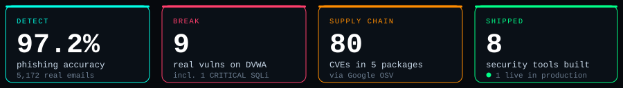

<div align="center">



<br>

<a href="https://tryhackme.com/p/seasonsofyjinn"></a>
<a href="https://cve-dashboard-pup2.onrender.com"></a>
<a href="https://www.linkedin.com/in/chamikaranaweera/"></a>
<a href="mailto:chamikaranaweera30@gmail.com"></a>

<br><br>



</div>

<br>

## `~/whoami`

```console
chamika@sec-lab:~$ cat whoami.txt
name         Chamika Ranaweera
role         Cybersecurity undergraduate
location     Sri Lanka
focus        network security · web app security · threat intelligence
philosophy   Don't just study attacks - build the tools that detect them.
goal         cybersecurity internship abroad (2026)
status       [ONLINE] shipping tools, breaking labs, learning in public
```

I learn security by building the tools defenders use: a phishing classifier, a packet analyzer, a web scanner, a live CVE feed, supply-chain scanners. Then I point them at real targets (labs, real datasets, real vulnerability databases) and see what breaks.


## `~/git log --graph` — how I got here

```console
chamika@sec-lab:~$ git log --oneline --graph
* ???????  internship                 a real security team, abroad, 2026    <- next
* a8e41f2  digital-security-toolkit   k-anonymity breach check + metadata stripper
* 7c3b9d0  sbom-scanner               CycloneDX 1.4 SBOMs checked against OSV
* 51fa6e8  dependency-scanner         80 CVEs surfaced across 5 packages
* 3d92c74  email-auth-analyzer        SPF / DKIM / DMARC + look-alike domains
* e07b1a5  cve-dashboard              deployed LIVE, pulling from NIST NVD
* 9b6d3f1  web-vulnerability-scanner  9 vulns on DVWA, 1 CRITICAL SQLi
* 4c8a2e7  network-analyzer           port scans + ARP spoofing, caught live
* 1f5e0b3  phishing-detector          97.20% accuracy on 5,172 real emails
* 0000000  init                       curiosity
```


## `~/live` — running in production right now

<div align="center">

### CVE Intelligence Dashboard

**Real-time vulnerability intelligence from the NIST National Vulnerability Database.**
Shows CVEs published in the last 24 hours, with severity filtering, trend charts and a searchable history.

<a href="https://cve-dashboard-pup2.onrender.com"></a>
&nbsp;
<a href="https://github.com/chamika-r/cve-dashboard"></a>

<sub>Free hosting: the first load can take ~30 seconds to wake the server up.</sub>

`Python` `Flask` `SQLite` `Chart.js` `Render`

</div>


## `~/case-files` — 8 tools, each built to answer a real threat

<sub>Click a case to open it. Every case follows the same shape: the threat, what I built, and what came out of it.</sub>

<details>
<summary><b>CASE 001</b> &nbsp;·&nbsp; Phishing Email Detector &nbsp;·&nbsp; <code>97.20% accuracy</code></summary>

- **Threat:** Phishing is still the front door for most intrusions, and users can't tell why a message looks wrong.
- **Built:** A Logistic Regression model trained on **5,172 real emails**, wrapped in a Flask REST API. Every prediction comes back with a confidence score and a plain-English explanation of the suspicious indicators.
- **Result:** 97.20% accuracy.

`Python` `scikit-learn` `Flask` `pandas` &nbsp;→&nbsp; [**Repository**](https://github.com/chamika-r/phishing-detector)

</details>

<details>
<summary><b>CASE 002</b> &nbsp;·&nbsp; Network Packet Analyzer &nbsp;·&nbsp; <code>port scans + ARP spoofing, live</code></summary>

- **Threat:** Recon and man-in-the-middle attacks leave fingerprints on the wire long before anything else breaks.
- **Built:** A real-time analyzer that captures live packets with Scapy and detects **port scanning** and **ARP spoofing** as they happen, shown in a Rich terminal dashboard that refreshes every 0.5 seconds.
- **Result:** Live alerts on suspicious network activity, straight from the wire.

`Python` `Scapy` `Rich` &nbsp;→&nbsp; [**Repository**](https://github.com/chamika-r/network-analyzer)

</details>

<details>
<summary><b>CASE 003</b> &nbsp;·&nbsp; Web Vulnerability Scanner &nbsp;·&nbsp; <code>9 vulns found · 1 CRITICAL</code></summary>

- **Threat:** The OWASP Top 10 classes of bugs that keep showing up in real web apps.
- **Built:** A scanner that tests for OWASP Top 10 vulnerabilities and produces a professional PDF penetration-test report with severity ratings and remediation guidance.
- **Result:** Pointed at DVWA, it found **9 real vulnerabilities**, including a **CRITICAL SQL injection**.

`Python` `BeautifulSoup` `Click` `ReportLab` &nbsp;→&nbsp; [**Repository**](https://github.com/chamika-r/web-vulnerability-scanner)

</details>

<details open>
<summary><b>CASE 004</b> &nbsp;·&nbsp; CVE Intelligence Dashboard &nbsp;·&nbsp; <code>LIVE</code></summary>

- **Threat:** New vulnerabilities are published every day and nobody has time to read the feed.
- **Built:** A dashboard that pulls data from the NIST NVD in real time, stores it in SQLite, and presents CVEs from the last 24 hours with severity filters, trend charts and search.
- **Result:** Deployed and **running live**: [open it](https://cve-dashboard-pup2.onrender.com).

`Python` `Flask` `SQLite` `Chart.js` `Render` &nbsp;→&nbsp; [**Repository**](https://github.com/chamika-r/cve-dashboard) · [**Live demo**](https://cve-dashboard-pup2.onrender.com)

</details>

<details>
<summary><b>CASE 005</b> &nbsp;·&nbsp; Email Authentication Analyzer &nbsp;·&nbsp; <code>BEC risk score 0-100</code></summary>

- **Threat:** Business Email Compromise: spoofed senders and look-alike domains (`paypa1.com` posing as `paypal.com`).
- **Built:** A tool that takes a raw `.eml` file, checks **SPF, DKIM and DMARC** with live DNS lookups, detects look-alike domains using Levenshtein distance, and combines everything into a 0-100 risk score. Available as a CLI and a web UI.
- **Result:** A single, explainable verdict for a suspicious email.

`Python` `dnspython` `Flask` &nbsp;→&nbsp; [**Repository**](https://github.com/chamika-r/email-auth-analyzer)

</details>

<details>
<summary><b>CASE 006</b> &nbsp;·&nbsp; Dependency Vulnerability Scanner &nbsp;·&nbsp; <code>80 CVEs in 5 packages</code></summary>

- **Threat:** Most of the code in a project is code somebody else wrote, and it ages badly.
- **Built:** A scanner for Python (`requirements.txt`) and Node.js (`package.json`) dependencies that checks them against the **Google OSV database**, the same data behind GitHub Dependabot. It reports fix versions and generates PDF reports.
- **Result:** 80 CVEs surfaced across 5 packages in testing.

`Python` `OSV API` `Flask` `ReportLab` &nbsp;→&nbsp; [**Repository**](https://github.com/chamika-r/dependency-scanner)

</details>

<details>
<summary><b>CASE 007</b> &nbsp;·&nbsp; SBOM Generator + Scanner &nbsp;·&nbsp; <code>CycloneDX 1.4</code></summary>

- **Threat:** Software supply-chain attacks, and regulators now asking vendors to prove what is inside their software.
- **Built:** A generator that walks a project directory and produces a formal **CycloneDX 1.4** Software Bill of Materials with Package URLs, then cross-references every component against OSV and exports the SBOM as JSON. Built around the SBOM expectations of US Executive Order 14028 and the EU Cyber Resilience Act.
- **Result:** From source tree to standards-based SBOM to vulnerability report in one run.

`Python` `CycloneDX` `OSV API` `Flask` &nbsp;→&nbsp; [**Repository**](https://github.com/chamika-r/sbom-scanner)

</details>

<details>
<summary><b>CASE 008</b> &nbsp;·&nbsp; Digital Security Toolkit &nbsp;·&nbsp; <code>privacy by design</code></summary>

- **Threat:** Leaked passwords, and photos that quietly carry your GPS location and device details.
- **Built:** Two privacy tools. A **password breach checker** using HIBP k-anonymity, where only a 5-character SHA-1 prefix is ever sent and the password never leaves the device. And an **image metadata stripper** that removes GPS, device info and timestamps from photos.
- **Result:** A breach check where the password itself never leaves the device.

`Python` `HIBP API` `Pillow` `Flask` &nbsp;→&nbsp; [**Repository**](https://github.com/chamika-r/digital-security-toolkit)

</details>


## `~/skills` — every claim has a receipt

<sub>No self-rated progress bars. Each skill links to the project that proves it.</sub>

| Domain | What I can do | Receipt |
|:--|:--|:--|
| **Network security** | Capture and analyze live traffic, detect port scans and ARP spoofing | [network-analyzer](https://github.com/chamika-r/network-analyzer) |
| **Web app security** | Test for OWASP Top 10 issues, validate findings on DVWA, write pentest reports with remediation | [web-vulnerability-scanner](https://github.com/chamika-r/web-vulnerability-scanner) |
| **Email & identity security** | Analyze SPF / DKIM / DMARC, detect look-alike domains, score BEC risk | [email-auth-analyzer](https://github.com/chamika-r/email-auth-analyzer) |
| **Supply-chain security** | Scan dependencies against OSV, generate CycloneDX SBOMs | [dependency-scanner](https://github.com/chamika-r/dependency-scanner) · [sbom-scanner](https://github.com/chamika-r/sbom-scanner) |
| **Threat intelligence** | Ingest and present live NVD data, ship it as a deployed service | [cve-dashboard](https://github.com/chamika-r/cve-dashboard) |
| **ML for security** | Feature engineering and model training for detection, explainable outputs | [phishing-detector](https://github.com/chamika-r/phishing-detector) |
| **Privacy engineering** | k-anonymity protocols, metadata removal | [digital-security-toolkit](https://github.com/chamika-r/digital-security-toolkit) |

<div align="center">


<sub>Scapy · OWASP Top 10 · MITRE ATT&CK · OSV · HIBP · CycloneDX · pandas · numpy · BeautifulSoup · Chart.js · Render</sub>

</div>


<!-- ================= CTF SECTION ================= -->

## `~/ctf` — can you breach this profile?

<div align="center">

</div>

<br>

I hid a flag somewhere in this profile. You don't need to install anything and there is nothing to attack: **everything you need is in this README and in the [`ctf/`](ctf/) folder.** It takes three techniques (decoding, recon, log analysis) and about 10-20 minutes. Solve it, claim your flag, and get on the wall of fame.

Flag format: `FLAG{...}`

```text
============ INTERCEPTED TRANSMISSION 0x01 ============
Tm90IGV2ZXJ5dGhpbmcgb24gdGhpcyBwYWdlIGlzIHJlbmRlcmVkLiBSZWFkIHRoZSByYXcgc291cmNlLg==
=======================================================
```

<!--
  STAGE 1 :: cipher text
  Fgntr 1 pyrne. N jro freire jnf cbccrq va gur rneyl ubhef bs 14 Frc 2026. Gur rivqrapr vf va pgs/npprff.ybt. Svaq gur VC gung oehgr-sbeprq /nqzva/ybtva NAQ tbg va, gura ybbx ng jung vg chyyrq bhg arkg. Ybbg vf rapbqrq gjvpr.
-->

<details>
<summary><b>Stuck? Open a hint</b> (spoiler-light, one per stage)</summary>

- **Stage 0:** The transmission ends in `=`. That's a big clue about the encoding.
- **Stage 1:** Browsers don't render everything they're given. On github.com you can view this file's **Raw** source. One of the things a browser hides is *comments*. The text you'll find uses one of the oldest ciphers there is: a rotation by 13.
- **Stage 2:** Start with who is hammering the login page:
  `grep ' 401 ' ctf/access.log | awk '{print $1}' | sort | uniq -c | sort -rn`
  Not everyone with a few `401`s is an attacker. Look for the source that fails **many** times and then **succeeds** (`302`), then read what that same IP requested *afterwards*. Several requests carry a `ref=` value; only one belongs to the attacker.
- **Stage 2 (decoding):** Loot is encoded twice: **hex**, then **base64**. Try `echo <hex> | xxd -r -p | base64 -d`.

</details>

### Stage 3: claim your flag

Your flag never has to appear in public. Instead, submit a **salted proof of solve**: the SHA-256 of your flag joined to your (lowercase) GitHub username.

```bash
printf '%s' 'FLAG{your_flag_here}:your-github-username' | sha256sum
```

Then [**open a claim issue**](https://github.com/chamika-r/chamika-r/issues/new?title=%5BCTF%5D%20flag%20claim&body=proof%3A%20PASTE_YOUR_SHA256_HERE) with the hash in the body. A GitHub Action checks it, and if it's right you're labelled **pwned**, closed out, and listed on the wall of fame. The first solver gets **first blood**.

<div align="center">

<a href="https://github.com/chamika-r/chamika-r/issues?q=is%3Aissue+label%3Apwned"></a>
&nbsp;
<a href="https://github.com/chamika-r/chamika-r/issues/new?title=%5BCTF%5D%20flag%20claim&body=proof%3A%20PASTE_YOUR_SHA256_HERE"></a>

<sub>Bonus: the workflow that checks claims is public in <code>.github/workflows</code>. Untrusted issue text is passed through environment variables, never interpolated into the shell. Read it, and try to break it responsibly.</sub>

</div>


## `~/now`

```console
chamika@sec-lab:~$ cat now.txt
[building]   cloud security and AI security tools
[studying]   working through a Cyber Attack Encyclopedia
[hunting]    a cybersecurity internship abroad, 2026
[ask me]     BEC detection · SBOMs · supply-chain security
```

<div align="center">

<br>

```console
chamika@sec-lab:~$ fortune
"Security is not a product, it's a process." - Bruce Schneier
```

<sub>No third-party stat widgets or trackers here. Every graphic in this profile is a hand-written SVG in <a href="assets"><code>/assets</code></a>.</sub>

</div>
